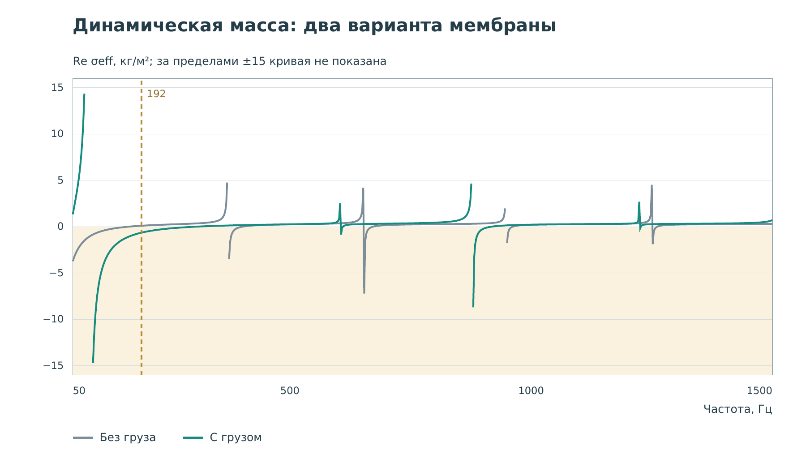

# Работа 1. Мембрана с грузом {#lab-mass}

## Цель и результат

Выяснить, как груз меняет прохождение звука, и прочитать знак динамической
поверхностной массы. До запуска ответьте: на всех ли частотах груз ослабит
прошедший импульс?

## Как устроен образец

Натянутая мембрана радиусом 10 мм соединена с центральным диском радиусом
3 мм; добавленный груз - 0,3 г. Воздух по обе стороны представлен
одномерными портами. Это собственный образец стенда, а не точная
реплика [Yang и соавторов, 2008](../references.md#ref-yang2008).

В статье части мембраны движутся противофазно, и их среднее движение
может почти обнулиться. Местные колебания при этом остаются сильными.
Идею внутреннего резонатора поясняет
[книга, гл. 1, с. 4-9](../references.md#ref-book).

## Что показано на графиках

Динамическая поверхностная масса связывает перепад давления
$\Delta p=p_\text{слева}-p_\text{справа}$ со средним ускорением:

$$
\sigma_\mathrm{eff}(\omega)=
\frac{\widehat{\Delta p}(\omega)}
     {\langle\widehat a_n(\omega)\rangle}.
$$

Шляпка обозначает комплексную амплитуду гармонического колебания,
угловые скобки - среднее по мембране. Единица $\sigma_\mathrm{eff}$ -
кг/м², не граммы груза и не плотность в кг/м³.
Отрицательная Re $\sigma_\mathrm{eff}$ означает противофазную компоненту
этого отношения. Обычная масса вещества остаётся положительной.

Когда среднее ускорение почти нулевое, отношение резко растёт.
Обрезанные пределом графика участки не являются физически плоской
характеристикой. На карте цвет показывает давление, а изгиб мембраны
увеличен для видимости.

## Порядок работы

1. Откройте **«01 · Отрицательная масса»**, выберите **192 Hz**.
2. Справа включите **«Мембрана без добавленного груза»**.
   Запустите импульс и нажмите на канал около $x=0{,}8$ м.
   Запишите фактическую координату. Карты и две записи должны совпасть.
3. Выберите **«Мембрана с грузом»**, верните время в начало.
   После прихода волны поставьте паузу: сравните движение диска и гибкой части.
4. В той же точке справа сравните размах, задержку и форму прошедших записей.
   Высота пика давления не равна переданной энергии.
5. Переставьте датчик примерно в $x=-0{,}8$ м.
   Найдите возвращающуюся волну по времени; вся запись слева содержит
   и падающий, и отражённый импульсы.
6. На частотной характеристике найдите жёлтую вертикаль и знак Re
   $\sigma_\mathrm{eff}$ обоих образцов.
7. Повторите сравнение справа для **«Ниже резонансной области»**
   (54,6 Гц) и **«Выше антирезонанса»** (362,4 Гц).
   Сохраняйте координату; сравнивайте физическое время, не положение ползунка.
8. Заполните таблицу и вернитесь к начальному предсказанию.

| Частота, Гц | Знак Re σ без груза | Знак Re σ с грузом | Изменение передачи |
|---:|---|---|---|
| 54,6 | Измерить | Измерить | Описать |
| 192 | Измерить | Измерить | Описать |
| 362,4 | Измерить | Измерить | Описать |

## Что должно получиться

При 192 Гц гармоническая диагностика даёт около +0,104 кг/м² без груза
и -0,648 кг/м² с грузом. Знак взят из рассчитанного отношения,
а не измерен по цвету кадра. Контроль без груза тоже имеет собственные
моды и не обязан давать положительную динамическую массу везде.

## Вопросы и отчёт

Почему мембрана может сильно двигаться местами, но слабо в среднем?
Доказывает ли слабая передача отрицательную массу без частотной диагностики?

Сохраните одну запись справа, таблицу и короткий ответ на начальный вопрос.
Назовите частоту и контроль; не переносите результат на все режимы.
