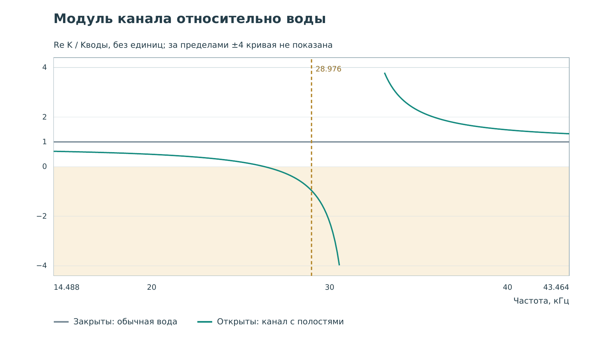

# Работа 2. Канал с резонаторами Гельмгольца {#lab-bulk}

## Цель и результат

Разобраться, как боковая полость меняет прохождение звука по каналу.
Научиться отличать давление в основном канале от давления в резонаторе
и динамический модуль всей ячейки от обычного модуля воды.

Перед запуском запишите предсказание: «Если прошедший импульс стал слабее,
куда могла уйти энергия?» Не ограничивайтесь одним ответом.

## Устройство и происхождение идеи

У резонатора Гельмгольца есть узкая горловина и сравнительно широкая
закрытая полость. Жидкость в горловине обладает инерцией; сжатие жидкости
в полости даёт возвращающее действие. Это акустический аналог груза
на пружине, но вместо перемещения груза удобно считать объёмный поток
и давление.

В [статье Fang и соавторов, 2006](../references.md#ref-fang2006), цепочка
водяных резонаторов использована для ультразвуковой среды с отрицательным
динамическим модулем около резонанса. В стенде мы считаем одномерную
пассивную сеть канала и боковых ветвей, а не полный трёхмерный корпус
опубликованного образца.

Связь резонатора с механическими и электрическими аналогами разобрана
в [книге, гл. 1, с. 6–9](../references.md#ref-book). Аналогия помогает
понять инерцию и податливость, но не позволяет переносить параметры
одного физического устройства в другое без пересчёта единиц.

## Как читать схему

Основной цветной прямоугольник — канал вдоль оси $x$. Поперечное
распределение давления не рассчитывается. Прямоугольники выше —
боковые полости в своих положениях по $x$; одна увеличена для пояснения.
Цвет всей полости означает одно рассчитанное давление, не вихрь
и не двумерную волну внутри неё.

У канала и полостей **разные численные цветовые диапазоны**. Они
подписаны двумя шкалами под картами. Одинаковый оттенок в канале
и в увеличенной полости не обязан означать одинаковое давление.
В пределах одной из этих шкал контроль и выбранный образец сравниваются
без независимого растяжения яркости.

## Две полезные формулы

Для малого резонатора обозначим через $L_h$ акустическую инерцию
горловины, а через $C_h$ податливость полости. Тогда

$$
f_h=\frac{1}{2\pi\sqrt{L_hC_h}}.
$$

В модели горловины постоянного сечения приближённо
$L_h=\rho\ell/S$, где $\ell$ — длина, $S$ — площадь горловины.
Для полости $C_h=V/K$, где $V$ — её объём. Отсюда видно, почему
удлинение горловины или увеличение полости обычно понижает резонанс
в таком приближении. В реальной геометрии нужны поправки и проверка.

Сжимаемость эффективной среды $\beta_\mathrm{eff}$ и её объёмный
модуль связаны как $K_\mathrm{eff}=1/\beta_\mathrm{eff}$. На графике
показано $\operatorname{Re}K_\mathrm{eff}/K_\text{воды}$, то есть
отношение без единиц. Уровень 1 соответствует обычной воде.

## Опыт А. Откройте и закройте ветви

1. Выберите **«02 · Отрицательный модуль»**.
2. Оставьте набор **«Отрицательный модуль»**, примерно 28,98 кГц.
3. Справа выберите **«Горловины закрыты · прямой канал»**.
4. Запустите импульс. Карты должны совпасть с контролем.
5. Выберите **«Горловины открыты · резонаторы работают»** и начните
   запись заново. Проследите прохождение пакета через область полостей.
6. Поставьте датчик в канале за ними, приблизительно $x=0{,}60$ м.
   Запишите координату и сравните прошедшие импульсы.
7. Перенесите датчик перед полостями, приблизительно $x=0{,}10$ м.
   Сравните позднюю часть записей. Отличие перед и после структуры
   помогает различать отражение и передачу.

Попытка поставить датчик в увеличенную полость не перемещает его туда:
эта вставка не является рассчитанной двумерной областью наблюдения.

## Опыт Б. Посмотрите, что осталось после импульса

1. Оставьте открытые горловины.
2. Просмотрите запись до конца, особенно после основного пакета.
3. Найдите, продолжают ли полости менять цвет. Если да, объясните,
   почему источник мог уже выключиться, а движение ещё не прекратилось.
4. По двум шкалам оцените порядок давления в канале и в полостях.
   Не сравнивайте их только по оттенкам.

Если полость звенит, это говорит о временном накоплении и отдаче
колебаний. Для утверждения о поглощении нужны материальные потери
и энергетический баланс, а не просто исчезновение яркого пакета справа.

## Опыт В. Смените частоту

Повторите сравнение для наборов **«Ниже резонанса полостей»** и
**«Выше запрещённой полосы»**. На каждом шаге возвращайте датчик
в одну и ту же точку за резонаторами и записывайте частоту.

| Набор | Частота, кГц | Re K / Kводы при открытых ветвях |
|---|---:|---|
| Ниже резонанса | 19,76 | Измерить по карточке |
| Отрицательный модуль | 28,98 | Измерить по карточке |
| Выше полосы | 39,51 | Измерить по карточке |

В подготовленных данных эти отношения приблизительно равны 0,51,
−0,96 и 1,52. При закрытых горловинах остаётся 1. Частота отдельной
ветви модели около 26,34 кГц. Таблица проверяет чтение карточки,
не заменяет ваше сравнение временных записей.

## Почему модуль может быть отрицательным

В статике положительное давление сжимает обычную воду. В динамике
внутреннее движение полости запаздывает. Усреднённое сжатие ячейки
и давление могут иметь противофазные компоненты. Отрицательный
динамический модуль описывает эту связь на определённой частоте.

Сама вода не приобрела отрицательную статическую жёсткость. Если
выключить возбуждение, пассивная модель не должна самопроизвольно
раскачиваться. Резонансное запаздывание — часть модели, которую нельзя
удалить, оставив во временном уравнении только постоянное отрицательное K.

## Вопросы и отчёт

1. Почему у полостей отдельная цветовая шкала?
2. Какие наблюдения поддерживают объяснение через отражение?
3. Можно ли по провалу передачи узнать знак K без модели или
   дополнительных измерений?
4. Чем давление в одной полости отличается от эффективного модуля
   цепочки полостей?

Сдайте две записи в точках до и после резонаторов, таблицу частот
и короткое объяснение позднего звона. Отдельно укажите: рисунок
одномерный по физике, хотя схема имеет высоту на экране.
