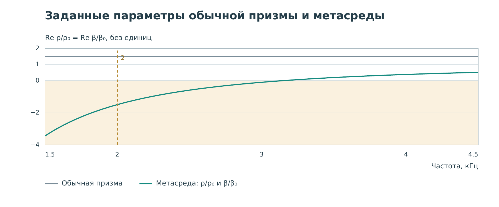

# Работа 3. Преломление в заданной метасреде {#lab-refraction}

## Цель и результат

Сравнить выходящий волновой пакет у обычной и дисперсионной призмы.
Научиться определять направление относительно нормали к границе,
а не относительно края экрана, и отличать изменение направления от
поглощения.

## Что взято из литературы, а что задано нами

В [работе Xie и соавторов, 2013](../references.md#ref-xie2013), звук
проходит по извилистым воздушным каналам. Отрицательный индекс проверен
портовыми измерениями и опытом с призмой. Наша карточка использует
**заданную эффективную дисперсионную среду**. Каналы этой статьи внутри
треугольника не рассчитываются.

Это существенное различие. По картинке стенда можно исследовать
последствия выбранного закона свойств. Нельзя заключить, что мы уже
нашли конкретный лабиринт, который этот закон реализует. Между этими
задачами нужны проектирование ячейки, извлечение параметров и проверка.

В [книге, гл. 1, с. 1–10](../references.md#ref-book), преломление
связано с историей эффективных сред и периодических структур.
Книга отдельно различает режим локальных резонансов и режим, где
длина волны сравнима с периодом решётки. Не всякое необычное направление
пучка означает один и тот же физический механизм.

## Геометрия и обозначения

Призма — треугольная область с иными свойствами, чем окружающий воздух.
Жёлтый пунктир показывает нормаль к выходной границе. Нормаль — линия,
перпендикулярная поверхности. Углы падения и преломления отсчитывают
от неё, не от самой поверхности.

Для обычной однородной границы закон Снеллиуса записывают как

$$
n_1\sin\theta_1=n_2\sin\theta_2.
$$

Здесь $n$ — фазовый показатель, $\theta$ — угол к нормали.
Для конечного импульса картина сложнее луча: есть дифракция, конечная
ширина пучка и частотная зависимость. Поэтому не надо проводить
единственный луч через один яркий пик и объявлять его точным измерением.

В обычной призме карточки отношения плотности и сжимаемости к воздуху
равны 1,5. В метасреде они меняются с частотой и в выбранной модели
совпадают друг с другом. Это не массы в килограммах: отношение
$\rho/\rho_0$ безразмерно, как и $\beta/\beta_0$.

## Опыт А. Обычная призма

1. Откройте **«03 · Преломление»**.
2. Выберите набор **«Отрицательные инерция и сжимаемость»**, 2 кГц.
3. Справа выберите **«Обычная эффективная призма»**.
4. Запустите запись и дождитесь выхода пакета. Две карты должны
   совпадать: это ещё одна проверка контроля.
5. Поставьте датчик за призмой, примерно $x=0{,}4$ м, $y=0$.
   Запишите точное положение, показанное интерфейсом.
6. Остановите время после выхода пакета и опишите его направление
   относительно жёлтой нормали.

## Опыт Б. Включите дисперсионную среду

1. Выберите **«Дисперсионная метасреда»**.
2. Начните запись с нуля. Смотрите весь интервал: пакет справа может
   выйти позже, чем у обычной призмы. Не сравнивайте уже вышедший
   пакет слева с ещё не дошедшим справа.
3. Найдите участок после выходной границы, где различается направление.
   Сохраните этот кадр с обеими картами и временем.
4. Переставляйте датчик выше и ниже оси за призмой. Найдите, где записи
   становятся заметнее у каждого из двух вариантов.
5. Проверьте исходную точку. Если здесь сигнал стал слабее, определите,
   мог ли пакет просто уйти в другую сторону.

Для объяснения используйте форму всего фронта и несколько датчиков.
Неподвижная точка с малой амплитудой не является измерением общего
поглощения призмы.

## Опыт В. Три частотные области

Повторите опыт на 3 и 4,2 кГц. Смена частоты открывает готовый набор
с тем же типом геометрии. Запишите знаки параметров и качественное
направление выходящего пакета.

| Частота | Re ρ/ρ₀ = Re β/β₀ метасреды | Что наблюдали |
|---|---:|---|
| 2 кГц | Около −1,50 | Заполнить |
| 3 кГц | Около −0,111 | Заполнить |
| 4,2 кГц | Около +0,433 | Заполнить |

Название «вблизи нулевого индекса» у среднего набора не означает
точный ноль. В данном наборе действительные части ещё отрицательны.
Конечная полоса импульса дополнительно мешает описывать всю картину
единственным значением параметра на несущей.

## Разбор частотного графика

По горизонтали частота, по вертикали отношение к параметру воздуха.
Единичный уровень — воздух. Серая линия 1,5 — свойства обычной призмы.
Цветная кривая — свойства метасреды. Жёлтая вертикаль отмечает несущую
показанного импульса, точки показывают значения на ней.

Упрощённая связь для однородной скалярной акустики имеет вид

$$
k^2=\omega^2\rho\beta,
\qquad
n^2=\frac{\rho}{\rho_0}\frac{\beta}{\beta_0}.
$$

Одного квадрата $n^2$ недостаточно, чтобы выбрать знак $n$.
В дисперсионной среде выбор ветви согласуют с причинностью, потерями
и направлением переноса энергии. Поэтому правило «берём положительный
корень, раз произведение положительно» здесь не является полным решением.
Для этой работы достаточно знать, что цветные отношения — вход
эффективной модели и что изменение направления проверяется полем.

## Что нельзя заключить из опыта

Отрицательное преломление не означает, что импульс пришёл до включения
источника. Отрицательная динамическая плотность не делает отрицательной
массу воздуха. Видимый выходящий лепесток не доказывает субволновое
разрешение. У нас также нет результата оптимизации конкретной
трёхмерной лабиринтной ячейки.

## Вопросы и отчёт

1. Для чего нарисована нормаль?
2. Почему надо дождаться выхода обоих пакетов?
3. Как несколькими датчиками отличить отклонение от поглощения?
4. Что ещё надо рассчитать, чтобы изготовить такую метаструктуру?

Отчёт: три частоты, кадр с нормалью, сравнение двух точек датчика.
