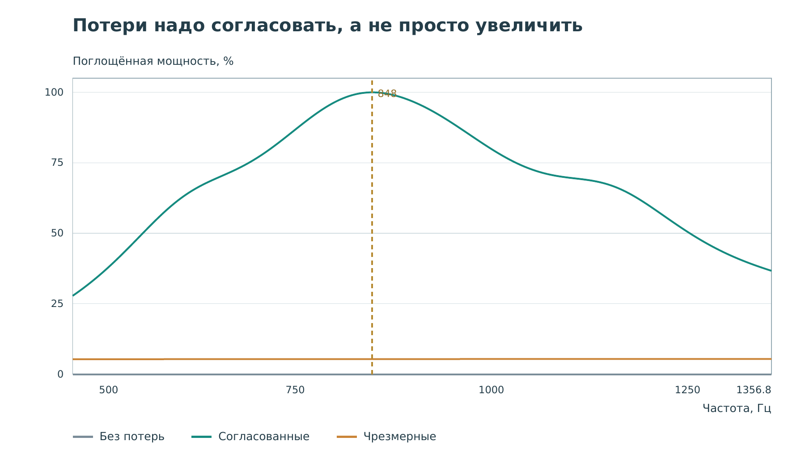
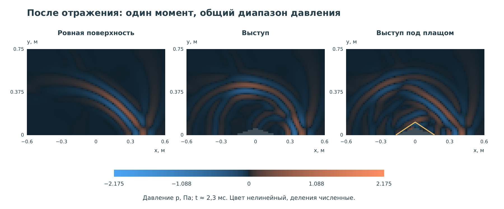
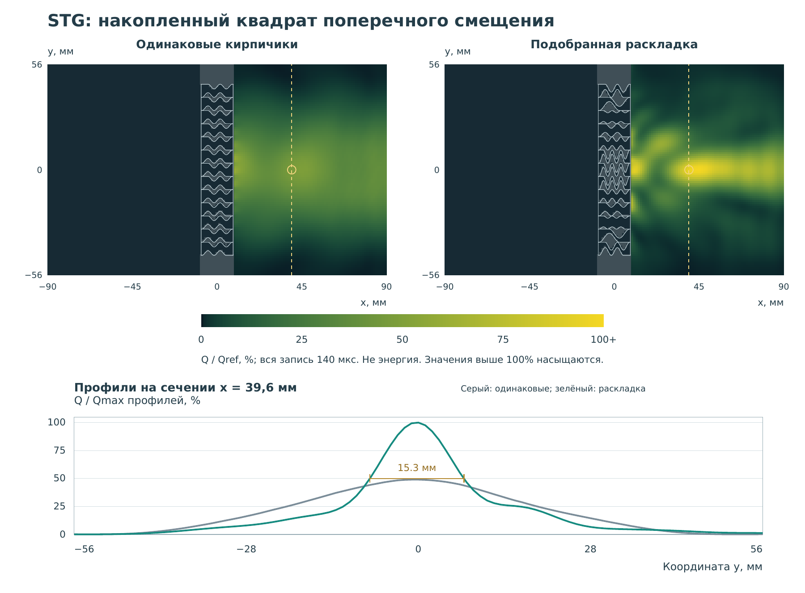

# О практикуме {#orientation}

В этом практикуме вы будете посылать волновой импульс, менять устройство
образца и сравнивать результаты. Программировать для этого не нужно.
Нужны работающий стенд, бумага или файл для записей и готовность проверять
свои объяснения, когда картинка им противоречит.

За пять работ вы познакомитесь с отрицательной динамической массой,
резонансной сжимаемостью, поглощением, акустической маскировкой
и фокусировкой упругих волн. У этих эффектов разные механизмы. Мы не будем
называть всякую тёмную область поглощением, а всякое яркое пятно фокусом.

## Что здесь считается опытом

Перед вами виртуальный испытательный стенд. Его библиотека `meta-ndt`
решает физические задачи, а приложение `meta-demo` показывает результаты.
Учебная коллекция использует заранее рассчитанные поля. Переключая образец,
вы открываете другой результат, а не запускаете построение сетки.

Датчик читает запись в выбранной точке сохранённого поля. Между узлами
выполняется интерполяция: небольшое перемещение мыши не означает нового
расчёта с бесконечно точным положением микрофона. Это нормальное свойство
виртуального прибора, но о нём важно помнить при измерениях.

У каждого опыта есть контроль: образец, с которым сравнивают изменение.
Например, в работе о мембране это мембрана без добавленного груза.
В работе о плаще это ровная отражающая поверхность. У STG-линзы контроль
тоже состоит из синусоидальных кирпичиков, но все они одинаковы.
Сравнивать надо не названия «обычный» и «мета», а конкретные записи при
заданном возбуждении.

## Почему форма материала может быть важнее состава

Представьте груз на пружине внутри коробки. Если медленно двигать коробку,
груз следует за ней. Если раскачивать около собственной частоты груза,
он заметно запаздывает и может двигаться в противоположную сторону.
Вещество не изменилось; изменились частота и совместное движение частей.

Так же устроена одна из идей метаматериалов. Мелкие элементы влияют на
более длинную волну, а их общий отклик описывают эффективными параметрами.
Эти параметры относятся к определённому режиму движения. Они не заменяют
обычные плотности и модули вещества во всех возможных опытах.

В [первой главе книги](#ref-book), с. 4-10, рядом разобраны
локальные резонансы, механические аналоги электрических цепей и границы
аналогии между акустикой и упругостью. Для нас важен порядок рассуждения:
сначала устройство ячейки и её движение, затем усреднённое свойство.
Одного необычного цвета на экране для такого вывода недостаточно.

## Небольшая историческая линия

В работе [Liu и соавторов, 2000](#ref-liu2000) использовались
тяжёлые шарики с мягким покрытием в твёрдой матрице. Наглядная деталь здесь -
внутренний резонатор: тяжёлая часть и мягкая связь. Потом появились другие
конструкции: водяные полости, мембраны, извилистые каналы и упругие перемычки.
Годы публикаций этих работ приведены в библиографии, а связи с нашими
образцами разобраны в соответствующих лабораторных работах.

Эта история полезна не как список «чудесных материалов». Она показывает,
что похожую волновую задачу можно решать разными устройствами и что
название эффекта ещё не объясняет, как работает конкретный образец.

## Маршрут занятий

| Работа | Что меняем | Что сравниваем |
|---|---|---|
| 1. Динамическая масса | Груз на мембране, частоту | Движение мембраны и передачу |
| 2. Объёмный модуль | Открытие боковых полостей | Давление, отражение и звон |
| 3. Поглощение | Потери в резонансной ячейке | Возвращающуюся волну |
| 4. Маскировка | Выступ и плащ над ним | Отличие от ровной поверхности |
| 5. STG-линза | Формы кирпичиков по высоте | Ширину прошедшего пучка |

Сначала прочитайте [главу о приборе](#workbench), затем выполните
первую работу. Если времени мало, лучше подробно пройти одну работу
с контролем и записью результата, чем быстро просмотреть все анимации.
Темп занятий выбирайте вместе с руководителем; это не экзамен на скорость.

## Три слоя утверждений

**Публикация.** Авторы статьи изготовили или рассчитали определённое
устройство. Их геометрия, частота и метод измерения принадлежат этой работе.

**Наш образец.** В стенде может использоваться другой размер, материал,
численная схема или упрощение. Например, плащ задан как эффективная
анизотропная среда: микроструктура пластин внутри него здесь не рассчитывается.

**Ваше наблюдение.** В конкретной точке и временном окне вы увидели
такое-то изменение. Это ещё не утверждение о любых частотах, направлениях
и материалах. Хороший отчёт ясно разделяет эти три слоя.

Книга Craster и Guenneau - источник понятий и связей между темами.
Наши лабораторные инструкции написаны заново под интерфейс стенда.
Рисунки в методичке построены по нашим данным или нарисованы как схемы;
изображения статей и страницы книги в открытый репозиторий не перенесены.

## Что сдавать после каждой работы

Сохраните условие сравнения, два-три осмысленных наблюдения и вывод.
Подробный образец протокола есть в [главе об измерениях](#measurements).
Число без единицы, рисунок без частоты и фраза «эффект хорошо виден»
не позволяют другому человеку повторить вашу работу.

Если предсказание оказалось неверным, не стирайте его. Напишите рядом,
какое наблюдение заставило изменить объяснение. Именно эта запись часто
полезнее красивого итогового скриншота.

# Как пользоваться стендом {#workbench}

Эта глава относится к основной коллекции «Метаматериалы: пять опытов».
Если вместо неё открыт редактор с кнопкой «Рассчитать опыт», вы попали
в исследовательский режим. Закройте его и запустите приложение без
дополнительных флагов по инструкции в README репозитория.

## Первое знакомство: один полный проход

1. Нажмите **«01 · Отрицательная масса»**.
2. Выберите **«Отрицательная эффективная масса · 192 Hz»**. Число рядом
   с кнопкой - частота внутри импульса. `Hz` означает герц.
3. Справа оставьте **«Мембрана с грузом»**. Слева всегда показан контроль.
4. Нажмите **«Запустить импульс»**, затем **«Пауза»**, когда волна пройдёт
   мембрану. Ползунок времени позволяет вернуться к любому кадру.
5. Найдите цветовую шкалу под картами. Прочитайте название величины
   и единицу, прежде чем сравнивать яркость.
6. Нажмите на цветной канал справа от мембраны. Жёлтый прицел обозначит
   точку датчика. Под картами появится её положение и две записи.
7. Нажмите **«↶ В начало»** и снова запустите запись. Сравните момент
   движения фронта на карте с жёлтой вертикалью на графике датчика.

При выборе другой частоты запись возвращается к началу. Это другой
готовый опыт. При перестановке датчика история остаётся той же: меняется
только точка чтения. Во время короткой загрузки набора кнопка запуска
может быть недоступна; дождитесь появления подписей и графиков.

## Верхняя пара карт

Слева - контроль, справа - выбранный вариант. На них показан **один и тот
же физический момент**, а цветовая шкала у двух карт общая. Она не
растягивается отдельно, чтобы слабый образец выглядел таким же ярким,
как сильный.

При смене частоты или режима поля диапазон может измениться. Поэтому
сравнение яркости двух скриншотов из разных режимов без подписанной
шкалы ненадёжно. Числа на самой шкале важнее впечатления «стало краснее».
Для видимости слабых волн палитра нелинейная: вдвое ярче не значит вдвое
больше смещение или давление.

В акустических опытах цвет обычно показывает отклонение давления от
равновесного. Синий - отрицательное отклонение, красный - положительное.
Отрицательное отклонение на несколько паскалей не означает отрицательного
абсолютного давления: атмосферное или гидростатическое давление здесь
уже вычтено.

В твёрдом STG-образце показано поперечное смещение $u_y$. Синий и красный
обозначают противоположные направления движения по оси $y$, а не две
разные среды. Жёлтая пунктирная линия отмечает сечение, по которому
построен профиль за линзой.

## Где можно поставить датчик

В двумерной задаче датчик перемещается по карте. В одномерном канале
меняется только координата $x$: поперечная координата не рассчитывалась.
Нажимайте на сам цветной канал, а не на увеличенную схему полости.

Если точка попала в пустоту или в область без нужной записи хотя бы
одного образца, приложение сообщает об этом. Отсутствие записи не равно
нулевому сигналу. Поставьте датчик в область, доступную в обоих вариантах.
Для трубки это вода снаружи, для STG - материал за стенкой.

Координаты датчика видны под графиком. В этой коллекции их не надо
вводить текстом. Попадать мышью в одну точку до последнего знака тоже
не требуется: в протоколе записывайте фактически показанные координаты.

## Нижняя пара графиков

**Слева - запись датчика во времени.** По горизонтали время, по вертикали
давление или смещение. Серым показан контроль, зелёным выбранный образец.
Названия образцов находятся в легенде. Две совпавшие кривые могут выглядеть
как одна - проверьте, не выбраны ли одинаковые варианты.

Жёлтая вертикаль показывает время верхнего кадра. Она не является порогом
обнаружения. Высокий пик - большое значение именно в точке датчика,
не полная энергия всей волны.

**Справа - показатель данного опыта.** В первых четырёх работах это
частотная характеристика: результат установившегося синусоидального
возбуждения на разных частотах. Жёлтая вертикаль отмечает несущую
показанного импульса. Этот график не является автоматически спектром
левой записи.

В работе о плаще справа дана разность двух записей во времени. В STG -
поперечный профиль за линзой. Читайте заголовок и подпись оси: место
графика на странице не определяет его физический смысл.

## Два специальных переключателя

У трубки **«Только эхо»** означает вычитание падающей волны из полного
давления. Меняются и карта, и сигнал микрофона. Включённый режим подписан
как рассеянное давление $p_s$; без галочки показывается полное давление $p$.
В основной задаче о плаще над выступом такого вычитания нет: там другой
эталон - ровная отражающая поверхность.

У STG **«Где прошла волна»** показывает след за всю запись:

$$
Q(x,y)=\int_0^T u_y(x,y,t)^2\,dt.
$$

Это неподвижная карта. Она не показывает, где импульс находится сейчас,
поэтому ползунок времени в этом режиме отключён. Кнопка **«Смотреть
импульс»** возвращает настоящее распространение во времени. Запись датчика
при смене этих двух видов не меняется.

## Что сохранять вручную

У основной коллекции нет кнопки экспорта вашего лабораторного отчёта.
Записывайте координаты, частоту и показания в свой протокол; скриншоты
делайте средствами системы. Не ищите здесь полку сохранённых расчётов,
CSV или произвольный ввод геометрии: эти возможности относятся к другим
исследовательским ноутбукам.

До закрытия приложения проверьте, что ваши заметки сохранены отдельно.
Остановка Julia не удаляет готовые поля, но и не сохраняет автоматически
то, что вы написали в другом несохранённом документе.

# Волны, резонанс и эффективные свойства {#waves}

Для начала достаточно различать три вещи: что движется, что измеряет
датчик и каким числом мы описываем отклик образца. Это не всегда одна
и та же величина.

## Давление и перемещение

Звук в воде или воздухе связан с небольшими сжатиями среды. Частицы
колеблются около равновесных положений; пакет переносит возмущение,
а не уносит всю воду из левого края сосуда в правый. В линейной модели
мы рассматриваем малые отклонения и не рассчитываем струи или турбулентность.

Микрофон измеряет давление $p$. Упругий датчик в STG-опыте показывает
смещение $u_y$. Давление измеряется в паскалях, смещение в единицах длины.
Кривую давления нельзя сравнивать по высоте с кривой смещения и говорить,
что одна волна «в тысячу раз сильнее».

В жидкости обычной модели есть продольная волна: движение частиц связано
со сжатием. Твёрдое тело сопротивляется ещё и сдвигу, поэтому там могут
распространяться продольные и поперечные волны. У свободного выреза они
могут превращаться друг в друга. Показ одной компоненты $u_y$ не выделяет
автоматически чистую сдвиговую моду.

Эта граница особенно важна при переносе идей из одной области в другую.
В [книге, гл. 1, с. 8-11](#ref-book), отдельно разобраны
скалярные аналогии и связанная векторная задача упругости. В гл. 4,
с. 86-87 и 104-106, видно, почему движение твёрдых стенок может менять
прохождение звука и почему «стенка жёсткая» - допущение, а не свойство
любого металла на любой частоте.

## Частота, период и длина волны

Частота $f$ показывает число колебаний за секунду. Период одного
колебания равен $T_0=1/f$. При скорости волны $c$ длина волны равна

$$
\lambda=\frac{c}{f}.
$$

Не путайте период $T_0$ с длительностью всей записи $T$. На записи
может быть много колебаний, пауза до прихода и звон после выключения
источника.

Например, при $c=343$ м/с и $f=1000$ Гц получаем $\lambda=0{,}343$ м.
Это пример расчёта для воздуха, не скорость сдвиговой волны в алюминии.
Чем меньше ячейка по сравнению с длиной волны, тем естественнее пытаться
описать множество ячеек как общую среду. Но само неравенство размеров
ещё не проверяет точность такого описания.

## Импульс и одна синусоида

Бесконечная синусоида имеет одну частоту. Короткий импульс содержит
диапазон частот. Даже если на кнопке написано «192 Hz», источник не
колеблется бесконечно: это частота внутри конечного пакета.

Поэтому глубокий провал передачи на одной частоте может не убрать
весь прошедший импульс. Узкий пик поглощения тоже не означает, что
весь короткий пакет поглотится с тем же коэффициентом. Эта разница
не является ошибкой графика: два графика могут отвечать на разные вопросы.

## Резонанс и фаза

Резонатор умеет временно накапливать движение и упругую деформацию.
После выключения источника он может продолжать звенеть. Большое
движение внутри образца не обязательно означает хорошую передачу
через него: накопленное движение может излучиться назад.

Фаза описывает положение внутри цикла. Если два колебания достигают
максимума одновременно, они синфазны. Если максимум одного совпадает
с минимумом другого, они противофазны. При сложении волн важны и
амплитуды, и фазы. Два больших вклада могут почти взаимно сократиться.

Для иллюстрации возьмём $a(t)=A\cos\omega t$ и
$b(t)=B\cos(\omega t+\varphi)$, где $\omega=2\pi f$.
При $A=B$ и $\varphi=\pi$ сумма равна нулю. Это не исчезновение
слагаемых. В физических задачах надо ещё выяснить, куда уходит поток
энергии и что измеряется вне выбранной точки.

## Масса, модуль и сжимаемость

Плотность $\rho$ связывает объём и массу вещества. Динамическая
эффективная плотность описывает усреднённый инерционный отклик структуры
при колебаниях. Для тонкой мембраны удобнее поверхностная масса $\sigma$:
она имеет единицу кг/м², не кг/м³.

Объёмный модуль $K$ связывает давление со сжатием. Если $\delta$
означает относительное уменьшение объёма, для обычного малого
статического сжатия $p=K\delta$. Сжимаемость $\beta=1/K$:
чем она больше, тем легче изменить объём.

При гармонических колебаниях отклик может запаздывать. Тогда параметры
удобно представлять комплексными числами. Действительная часть,
обозначенная `Re`, описывает синфазную компоненту выбранной связи.
Мнимая часть связана с квадратурной компонентой; её знак зависит от
принятого соглашения о времени. Для первых работ не требуется уверенно
считать комплексные числа: достаточно не путать знак динамического
параметра со знаком обычной массы вещества.

В модели без потерь возможна отрицательная действительная часть
динамического параметра. Сам этот знак не означает ни создания энергии,
ни отрицательных материальных масс. Нельзя также взять одно отрицательное
число с графика, вставить его как постоянную величину в обычное временное
уравнение и считать, что вся резонансная физика сохранена.

## Энергия и удобная мера сигнала

Квадрат давления или смещения удобен: положительные и отрицательные
полупериоды при суммировании не уничтожают друг друга. Но единицы важны:

$$
\int p^2dt\quad\text{имеет единицу Па}^2\!\cdot\text{с},
\qquad
\int u_y^2dt\quad\text{имеет единицу м}^2\!\cdot\text{с}.
$$

Ни одна из этих единиц не является джоулем. Для плоской бегущей волны
в однородной жидкости без потерь давление можно связать с интенсивностью
через импеданс $\rho c$. В ближнем поле, при интерференции или в упругом
теле такое превращение требует дополнительных условий и величин.

В упругом теле кинетическая энергия зависит от скоростей, а запасённая
упругая энергия - от деформаций и напряжений. В этой методичке след
$Q=\int u_y^2dt$ называется накопленным квадратом смещения, не энергией.
Он полезен для сравнения формы пучков, если одинаково заданы возбуждение,
время записи и нормировка.

## Проверка перед первой работой

Объясните своими словами, почему датчик может записать слабый сигнал,
хотя источник не выключен. Найдите хотя бы три объяснения: отражение,
отклонение пучка, задержка прихода, интерференционный минимум или
поглощение. В следующих работах вы будете различать эти причины,
а не выбирать одну по цвету картинки.

# Работа 1. Мембрана с грузом и динамическая масса {#lab-mass}

## Цель и результат

Выяснить, как центральный груз меняет движение мембраны и прохождение
звука. После работы нужно уметь отличить обычную массу вещества от
динамической поверхностной массы и объяснить, почему слабая передача
сама по себе не доказывает отрицательность последней.

Начальный вопрос для протокола: «На всех ли частотах добавление груза
уменьшит прошедшую волну?» Запишите ответ до запуска, не подглядывая
в следующие разделы.

## От статьи к нашему образцу

В работе [Yang и соавторов, 2008](#ref-yang2008), мембрана
с центральным грузом имеет необычный динамический отклик между модами.
Отдельные части могут двигаться, хотя среднее нормальное движение мало.
Так возникает возможность сильного отражения тонким образцом.

В нашем стенде осесимметричная натянутая мембрана соединена с жёстким
центральным диском. Её радиус 10 мм, радиус диска 3 мм, добавленный груз
0,3 г. Натяжение выбрано для нашего виртуального образца. Частоты и
показания ниже относятся к нему, а не к точному воспроизведению статьи.
Пространственное поле воздуха представлено одномерными портами.

Механический смысл резонансных эффективных параметров полезно сопоставить
с [книгой, гл. 1, с. 4-9](#ref-book). Небольшая структура
здесь ведёт себя сложнее, чем один свободный груз, потому что у неё есть
внутреннее движение и упругие связи.

## Что измеряется

Введём перепад давления $\Delta p=p_\text{слева}-p_\text{справа}$
и среднее нормальное ускорение мембраны $\langle a_n\rangle$.
Для гармонического режима поверхностную динамическую массу определяем как

$$
\sigma_\mathrm{eff}(\omega)=
\frac{\widehat{\Delta p}(\omega)}{\langle\widehat a_n(\omega)\rangle}.
$$

Шляпка означает комплексную амплитуду одного гармонического колебания.
Единица отношения - $(\text{Н}/\text{м}^2)/(\text{м}/\text{с}^2)
=\text{кг}/\text{м}^2$. Поэтому на частотном графике не плотность
материала и не масса груза в граммах.

Если усреднённое ускорение близко к нулю, отношение может резко возрастать.
Вблизи такого полюса извлечение чувствительно к малым изменениям.
Плоские участки на уровне ограничения графика - обрезание изображения,
а не физически постоянная масса.

## Опыт А. Сначала проверьте сравнение

1. Откройте **«01 · Отрицательная масса»**.
2. Выберите частоту **192 Hz**.
3. Справа включите **«Мембрана без добавленного груза»**.
4. Запустите импульс и поставьте датчик справа, приблизительно в
   $x=0{,}8$ м. Запишите показанную координату.
5. Убедитесь, что левая и правая карты совпадают, а кривые накладываются.
   Если видно одну линию, прочитайте легенду: это могут быть две
   одинаковые записи, а не пропавший график.

Без этого шага нет уверенности, что последующее различие связано с грузом,
а не с разными временами или непонятым управлением.

## Опыт Б. Добавьте груз

1. Не меняя частоты, выберите **«Мембрана с грузом»**.
2. Верните время в начало и снова запустите запись.
3. После прихода к мембране остановите анимацию. Посмотрите на центральный
   диск и гибкую часть. Форма изгиба увеличена для видимости.
4. Сравните прошедшие записи в той же точке справа. Отметьте не только
   высоту отдельного пика, но и форму, число заметных колебаний и задержку.
5. Переставьте датчик слева от мембраны, например около $x=-0{,}8$ м.
   Там запись содержит падающую и возвращающуюся волны. Не называйте
   весь максимум на этой стороне чистым отражением без разбора времени.
6. Найдите жёлтую вертикаль на частотной характеристике. Прочитайте
   действительную часть эффективной массы для обоих образцов.

На 192 Гц у подготовленного образца с грузом получается примерно
$-0{,}648$ кг/м², без добавленного груза - $+0{,}104$ кг/м².
Эти числа взяты из гармонической диагностики нашей модели. На карте
давления вы не измеряли знак эффективной массы напрямую.

## Опыт В. Проверьте своё начальное предсказание

1. Верните датчик вправо. Выберите **«Ниже резонансной области»**,
   примерно 54,6 Гц.
2. Снова сравните два образца в одинаковой точке. Длительность записи
   стала другой; смотрите на физическое время, не на положение ползунка.
3. Повторите сравнение для **«Выше антирезонанса»**, примерно 362,4 Гц.
4. Заполните таблицу. Высоту прошедшего импульса можно оценить по
   вертикальной шкале, но не выдавайте её за переданную энергию.

| Частота | Знак Re σ без груза | Знак Re σ с грузом | Что изменилось в передаче |
|---|---|---|---|
| 54,6 Гц | Заполнить | Заполнить | Заполнить |
| 192 Гц | Заполнить | Заполнить | Заполнить |
| 362,4 Гц | Заполнить | Заполнить | Заполнить |

У мембраны без добавленного груза тоже есть натяжение и собственные моды.
Она не обязана иметь положительную динамическую массу на всех частотах.
Название контроля не заменяет его физического анализа.

## Как объяснить результат

Отдельные части мембраны могут давать вклады разного знака в среднее
движение. При смене частоты меняется фаза ответа. Груз перестраивает
эти отношения, а не добавляет одно постоянное число ко всей динамической
характеристике.

Отрицательная Re σ означает противофазную компоненту связи перепада
давления со средним ускорением в выбранном гармоническом описании.
Это не утверждение, что груз начал падать вверх, приобрёл отрицательную
обычную массу или создаёт энергию.

## Вопросы для разбора

1. Почему нельзя определить знак σ по одному красному или синему кадру?
2. Может ли мембрана сильно колебаться локально, но почти не перемещать
   воздух в среднем?
3. Почему один и тот же груз помогает передаче на одной частоте и мешает
   на другой?
4. Что потребуется дополнительно, чтобы получить коэффициент переданной
   мощности, а не сравнение двух пиков давления?

В отчёт включите одну запись справа, таблицу трёх частот и исправленный
ответ на начальный вопрос. Если вывод не изменился, объясните, какие
наблюдения его поддержали.

# Работа 2. Канал с резонаторами Гельмгольца {#lab-bulk}

## Цель и результат

Разобраться, как боковая полость меняет прохождение звука по каналу.
Научиться отличать давление в основном канале от давления в резонаторе
и динамический модуль всей ячейки от обычного модуля воды.

Перед запуском запишите предсказание: «Если прошедший импульс стал слабее,
куда могла уйти энергия?» Не ограничивайтесь одним ответом.

## Устройство и происхождение идеи

У резонатора Гельмгольца есть узкая горловина и сравнительно широкая
закрытая полость. Жидкость в горловине обладает инерцией; сжатие жидкости
в полости даёт возвращающее действие. Это акустический аналог груза
на пружине, но вместо перемещения груза удобно считать объёмный поток
и давление.

В [статье Fang и соавторов, 2006](#ref-fang2006), цепочка
водяных резонаторов использована для ультразвуковой среды с отрицательным
динамическим модулем около резонанса. В стенде мы считаем одномерную
пассивную сеть канала и боковых ветвей, а не полный трёхмерный корпус
опубликованного образца.

Связь резонатора с механическими и электрическими аналогами разобрана
в [книге, гл. 1, с. 6-9](#ref-book). Аналогия помогает
понять инерцию и податливость, но не позволяет переносить параметры
одного физического устройства в другое без пересчёта единиц.

## Как читать схему

Основной цветной прямоугольник - канал вдоль оси $x$. Поперечное
распределение давления не рассчитывается. Прямоугольники выше -
боковые полости в своих положениях по $x$; одна увеличена для пояснения.
Цвет всей полости означает одно рассчитанное давление, не вихрь
и не двумерную волну внутри неё.

У канала и полостей **разные численные цветовые диапазоны**. Они
подписаны двумя шкалами под картами. Одинаковый оттенок в канале
и в увеличенной полости не обязан означать одинаковое давление.
В пределах одной из этих шкал контроль и выбранный образец сравниваются
без независимого растяжения яркости.

## Две полезные формулы

Для малого резонатора обозначим через $L_h$ акустическую инерцию
горловины, а через $C_h$ податливость полости. Тогда

$$
f_h=\frac{1}{2\pi\sqrt{L_hC_h}}.
$$

В модели горловины постоянного сечения приближённо
$L_h=\rho\ell/S$, где $\ell$ - длина, $S$ - площадь горловины.
Для полости $C_h=V/K$, где $V$ - её объём. Отсюда видно, почему
удлинение горловины или увеличение полости обычно понижает резонанс
в таком приближении. В реальной геометрии нужны поправки и проверка.

Сжимаемость эффективной среды $\beta_\mathrm{eff}$ и её объёмный
модуль связаны как $K_\mathrm{eff}=1/\beta_\mathrm{eff}$. На графике
показано $\operatorname{Re}K_\mathrm{eff}/K_\text{воды}$, то есть
отношение без единиц. Уровень 1 соответствует обычной воде.

## Опыт А. Откройте и закройте ветви

1. Выберите **«02 · Отрицательный модуль»**.
2. Оставьте набор **«Отрицательный модуль»**, примерно 28,98 кГц.
3. Справа выберите **«Горловины закрыты · прямой канал»**.
4. Запустите импульс. Карты должны совпасть с контролем.
5. Выберите **«Горловины открыты · резонаторы работают»** и начните
   запись заново. Проследите прохождение пакета через область полостей.
6. Поставьте датчик в канале за ними, приблизительно $x=0{,}60$ м.
   Запишите координату и сравните прошедшие импульсы.
7. Перенесите датчик перед полостями, приблизительно $x=0{,}10$ м.
   Сравните позднюю часть записей. Отличие перед и после структуры
   помогает различать отражение и передачу.

Попытка поставить датчик в увеличенную полость не перемещает его туда:
эта вставка не является рассчитанной двумерной областью наблюдения.

## Опыт Б. Посмотрите, что осталось после импульса

1. Оставьте открытые горловины.
2. Просмотрите запись до конца, особенно после основного пакета.
3. Найдите, продолжают ли полости менять цвет. Если да, объясните,
   почему источник мог уже выключиться, а движение ещё не прекратилось.
4. По двум шкалам оцените порядок давления в канале и в полостях.
   Не сравнивайте их только по оттенкам.

Если полость звенит, это говорит о временном накоплении и отдаче
колебаний. Для утверждения о поглощении нужны материальные потери
и энергетический баланс, а не просто исчезновение яркого пакета справа.

## Опыт В. Смените частоту

Повторите сравнение для наборов **«Ниже резонанса полостей»** и
**«Выше запрещённой полосы»**. На каждом шаге возвращайте датчик
в одну и ту же точку за резонаторами и записывайте частоту.

| Набор | Частота, кГц | Re K / Kводы при открытых ветвях |
|---|---:|---|
| Ниже резонанса | 19,76 | Измерить по карточке |
| Отрицательный модуль | 28,98 | Измерить по карточке |
| Выше полосы | 39,51 | Измерить по карточке |

В подготовленных данных эти отношения приблизительно равны 0,51,
−0,96 и 1,52. При закрытых горловинах остаётся 1. Частота отдельной
ветви модели около 26,34 кГц. Таблица проверяет чтение карточки,
не заменяет ваше сравнение временных записей.

## Почему модуль может быть отрицательным

В статике положительное давление сжимает обычную воду. В динамике
внутреннее движение полости запаздывает. Усреднённое сжатие ячейки
и давление могут иметь противофазные компоненты. Отрицательный
динамический модуль описывает эту связь на определённой частоте.

Сама вода не приобрела отрицательную статическую жёсткость. Если
выключить возбуждение, пассивная модель не должна самопроизвольно
раскачиваться. Резонансное запаздывание - часть модели, которую нельзя
удалить, оставив во временном уравнении только постоянное отрицательное K.

## Вопросы и отчёт

1. Почему у полостей отдельная цветовая шкала?
2. Какие наблюдения поддерживают объяснение через отражение?
3. Можно ли по провалу передачи узнать знак K без модели или
   дополнительных измерений?
4. Чем давление в одной полости отличается от эффективного модуля
   цепочки полостей?

Сдайте две записи в точках до и после резонаторов, таблицу частот
и короткое объяснение позднего звона. Отдельно укажите: рисунок
одномерный по физике, хотя схема имеет высоту на экране.

# Работа 3. Тонкий резонансный поглотитель {#lab-absorption}

## Цель и результат

Проверить, почему сильные потери не всегда дают хорошее поглощение.
Сравнить жёсткую стенку и три состояния мембраны с закрытой полостью.
Научиться отделять поглощение одной синусоиды от поглощения короткого
импульса.

До запуска расположите варианты по предполагаемому поглощению:
без потерь, согласованные потери, слишком большие потери. Запишите
не только порядок, но и причину своего выбора.

## Устройство ячейки

Мембрана с грузом находится перед закрытой воздушной полостью.
Задняя стенка не пропускает звук. Волна может либо вернуться в воздух
перед образцом, либо потерять энергию внутри структуры. Накопление
колебаний на некоторое время - ещё не окончательное поглощение:
при отсутствии потерь структура позднее отдаёт их обратно.

В [работе Ma и соавторов, 2014](#ref-ma2014), мембрана,
груз и газовая прослойка образуют резонансную поверхность с узким пиком
поглощения. В нашем образце используется воздух, глубина полости 25 мм
и своё натяжение мембраны. Это не копия газовой прослойки и всех
размеров опубликованного устройства.

Термин «метаповерхность» уместен для слоя структурированных ячеек,
но один пик на частотном графике не отличает автоматически метаматериал
от обычного резонатора. Здесь мы разбираем конкретный механизм:
как совместить резонансный отклик с подходящими потерями в тонкой ячейке.

## Импеданс без лишней терминологии

Импеданс связывает давление со скоростью движения среды. Если входной
отклик образца сильно отличается от отклика воздуха, значительная
часть звука отражается, ещё не возбудив полезное движение внутри.
Если связь согласована, волна лучше передаёт движение ячейке,
а внутренние потери могут превратить его в тепло.

Для нормального падения плоской гармонической волны в нашем
однопортовом описании

$$
r=\frac{Z_\mathrm{in}-Z_0}{Z_\mathrm{in}+Z_0},
\qquad Z_0=\rho_0c_0,
\qquad A=1-|r|^2.
$$

$r$ - отношение комплексных амплитуд отражённого и падающего давления,
$Z_\mathrm{in}$ - входной импеданс ячейки, $Z_0$ - импеданс воздуха.
$A$ - доля поглощённой мощности. Последняя формула применима здесь,
потому что задняя стенка исключает сквозную передачу. У открытой
структуры пришлось бы учесть и прошедшую мощность.

## Опыт А. Жёсткая стенка

1. Откройте **«03 · Поглощение»**.
2. Справа выберите **«Жёсткая стенка · отражение»**.
3. Поставьте датчик перед образцом, примерно $x=-0{,}4$ м.
4. Запустите импульс. Найдите раннюю падающую и более позднюю
   возвращающуюся части записи.
5. Убедитесь, что контроль и выбранный вариант совпадают.

На этом шаге запомните временной участок отражения. В следующих
сравнениях не принимайте ранний падающий пакет за отражённый.

## Опыт Б. Мембрана без потерь

1. Выберите **«Мембрана и полость · без потерь»**.
2. Перезапустите запись, сохранив положение датчика.
3. Смотрите на движение мембраны и позднюю часть сигнала.
4. Объясните, почему заметное движение не сделало этот вариант
   хорошим поглотителем.

Мембрана принимает движение и затем возвращает его в окружающий
воздух. В установившемся режиме поглощение без потерь равно нулю.
Это не запрещает временного хранения энергии и изменения формы
отражённого импульса.

## Опыт В. Согласованные и чрезмерные потери

1. Выберите **«Согласованные потери · поглощение»**.
2. Перезапустите запись и сравните именно возвращающийся пакет
   с контролем слева.
3. Прочитайте поглощение на несущей и найдите соответствующую точку
   правого частотного графика.
4. Затем выберите **«Слишком большие потери»** и повторите сравнение.
5. Вернитесь к своему начальному ранжированию. Объясните, совпало ли оно
   с результатом.

При чрезмерных потерях мембрана двигается слабо и вход плохо согласован
с воздухом. Звук в значительной мере отражается. Поэтому «материал
сильнее тормозит движение» не равнозначно «образец лучше поглощает
падающий звук».

## Что показывает частотная характеристика

Вертикальная ось - процент падающей мощности, ушедшей в потери при
синусоидальном возбуждении. Ноль означает отсутствие поглощения,
100% - отсутствие отражения в этой однопортовой модели. По горизонтали
частота. Жёлтая вертикаль стоит на несущей импульса, 848 Гц.

У подготовленного согласованного образца $A\approx0{,}99986$ на этой
частоте. Интерфейс округляет число почти до 100%. У варианта с
чрезмерными потерями здесь около 5,38%. Эти числа не означают,
что весь импульс поглощён в том же отношении: у него есть частотная
полоса, а у поглотителя - конечная ширина пика.

Оцените эту ширину по графику хотя бы грубо: найдите частоты, между
которыми поглощение превышает половину максимума. Запишите метод
оценки и не указывайте больше знаков, чем позволяет рисунок.

## Почему ячейка считается тонкой

При скорости звука в воздухе 343 м/с и частоте 848 Гц длина волны
около 404 мм. Глубина полости 25 мм составляет примерно $\lambda/16$.
Это сравнение геометрических размеров с длиной волны, а не заявление
о нулевой толщине или об отсутствии ограничений по полосе частот.

Изгиб мембраны и глубина на рисунке увеличены для видимости.
Не измеряйте глубину линейкой по скриншоту: число задано в подписи,
а сам рисунок частично схематический.

## Вопросы и отчёт

1. Куда девается движение у мембраны без потерь после окончания пакета?
2. Почему чрезмерные потери ухудшают согласование?
3. Какие два разных утверждения скрываются за фразой «поглощает 100%»?
4. Чем поглотитель отличается от плаща над отражающей поверхностью?

В отчёте сравните поздние записи всех четырёх вариантов, приведите
свою оценку полосы поглощения и вычисление $\lambda/16$.
В выводе назовите частоту и уточните, относится ли ваше число
к синусоиде или к конечному импульсу.

# Работа 4. Скрыть выступ, а не поглотить звук {#lab-cloaking}

## Цель и результат

Сравнить отражение от ровной поверхности, выступа и выступа под плащом.
Понять, почему хорошая маскировка означает близость к определённому
эталону, а не отсутствие всякого отражения.

## Идея из книги

В начале главы о трансформационной акустике Steven Cummer пишет:

> “Visualizing the device is the easy part.”

То есть представить желаемое устройство легко; труднее найти свойства
среды, которые действительно дадут нужное поле. Это короткая цитата
из [книги, гл. 8, с. 197](#ref-book). Она хорошо
описывает порядок этой работы: сначала выбираем эталон поля, затем
проверяем, приблизил ли к нему плащ реальный расчёт.

В [главе 7, с. 170-175](#ref-book), анизотропию поясняют
через структуры, которые мешают жидкости двигаться в одних направлениях
сильнее, чем в других. Обычная скалярная плотность тогда заменяется
тензорным инерционным откликом. Это не означает, что разные направления
весят по-разному на весах.

В [опыте Popa и соавторов, 2011](#ref-popa2011), слой
над выступом делает отражённые фронты ближе к фронтам от ровного
основания. Наша карточка использует эффективные анизотропные параметры,
а не подробную сетку отверстий всех перфорированных пластин.

## Прежде всего выберите правильный эталон

Если убрать выступ, останется твёрдая отражающая поверхность.
Она отражает звук. Поэтому задача плаща здесь - приблизить результат
к **ровной поверхности**, не к пустому пространству.

Это называют ground cloak или carpet cloak: маскировкой объекта
у отражающего основания. Из такого опыта нельзя заключить, что слой
скроет свободно лежащий предмет со всех сторон и на любых частотах.

В рассматриваемой анизотропной акустике

$$
\boldsymbol{\rho}\,\frac{\partial\mathbf v}{\partial t}=-\nabla p,
\qquad
\frac{\partial p}{\partial t}=-K\nabla\!\cdot\mathbf v.
$$

$\mathbf v$ - скорость жидкости, $p$ - давление, $K$ - модуль,
$\boldsymbol\rho$ - тензор плотности. Для прохождения работы не нужно
решать эти уравнения вручную. Они показывают, какой именно отклик
меняет слой и почему постоянная скалярная плотность не описывает
произвольную анизотропию.

## Опыт А. Выступ без плаща

1. Выберите **«04 · Акустический плащ»**, затем набор
   **«Плащ над выступом · 3 kHz»**.
2. Справа сначала включите **«Ровная отражающая поверхность»**.
   Запустите импульс: две карты и записи должны совпасть.
3. Выберите **«Выступ без плаща»** и начните с нуля.
4. Дождитесь отражения. Остановите кадр там, где возвратившийся фронт
   уже заметен над выступом. Запишите время.
5. Опишите отличие от ровной поверхности: изменилось направление,
   кривизна, задержка, появились дополнительные колебания?
6. Поставьте датчик над выступом, например около
   $x=0{,}15$ м, $y=0{,}26$ м. Запишите фактические координаты.

## Опыт Б. Наденьте плащ

1. Выберите **«Выступ под акустическим плащом»**.
2. Найдите тот же физический момент, который записали в опыте А.
3. Сравните фронт с ровной поверхностью слева.
4. Сравните запись датчика и график её отличия от эталона.
5. Переставьте датчик в другие точки над выступом. Возьмите хотя бы
   одну точку слева и одну справа от оси, оставаясь в жидкости.
6. Для каждой точки сначала сравните голый выступ с эталоном, затем
   покрытый. Не меняйте положение датчика между этими двумя записями.

График справа показывает $\Delta p(t)=p(t)-p_0(t)$, где $p_0$ - запись
над ровной поверхностью. Ноль означает совпадение в этой точке.
Отрицательная разность не означает отрицательную энергию или
автоматически более тихий звук.

## Как читать общую меру несовпадения

Для поля можно суммировать квадрат отличия по внешней области и времени:

$$
D=\int_{t_1}^{t_2}\int_\Omega
     [p(x,y,t)-p_0(x,y,t)]^2\,d\Omega\,dt.
$$

В подготовленном сравнении берётся область выше $y=0{,}18$ м
и временное окно от 1 до 2,8 мс. На этой общей области отношение
$D_\text{плащ}/D_\text{выступ}$ около 0,151. Это показатель всего
фиксированного сравнения, а не заново вычисляемая оценка вашего
одного микрофона.

Меньшее D означает близость к эталонному полю. D не является энергией:
его смысл задаёт именно разность давлений и выбранная область сравнения.
Если поменять эталон, область или временное окно, получится другая задача.

## Почему это не работа о поглощении

Хороший поглотитель старается уменьшить возвращающуюся волну.
Хороший плащ над выступом должен вернуть почти такую волну, какую
вернула бы ровная поверхность. Она может быть заметной и сильной.
Просто затемнить картинку справа потерями недостаточно.

Сравните формулировки: «эхо слабое» и «эхо похоже на эталон».
В этой работе проверяется второе. В [главе 10 книги, с. 241-248](#ref-book),
разобран другой подход - компенсация рассеяния оболочкой. Эти
два механизма не надо объединять словом «невидимость» без уточнения.

## Дополнительный опыт: трубка с резиной

В той же карточке откройте набор **«Трубка: резина снята / надета»**.
Теперь среда - вода, объект - полая стальная трубка с воздухом,
а слева контроль - **трубка без резины**. Это другой эталон.

1. Включите **«Только эхо»**. Из полного давления вычтена волна
   в пустой воде: $p_s=p-p_i$.
2. Сравните пустую воду, трубку без покрытия и с покрытием.
3. Поставьте микрофон перед трубкой, затем сбоку и сзади. Каждый раз
   запишите координаты и сравните обе трубки в одной точке.
4. Снимите галочку и убедитесь, что изменились карта и запись:
   теперь в них присутствует падающая волна.

Этот опыт связан с [работой Rohde и соавторов, 2015](#ref-rohde2015).
Мягкая оболочка меняет рассеяние упругой полой конструкции. Она не обязана
убирать любой резонанс. Если в готовом наборе записи почти совпали,
запишите это: нельзя обещать сильное подавление эха в каждой точке.
Отдельная тихая точка также не доказывает малого рассеяния во все стороны.

## Вопросы и отчёт

1. Почему эталон основной работы - не пустой воздух?
2. Как отличить восстановление фронта от простого ослабления?
3. Что изменится в смысле вывода, если выбрать другой эталон?
4. Почему результат одной точки нельзя переносить на всех наблюдателей?

Основной отчёт должен содержать три сравнимых кадра, записи хотя бы
в трёх точках и явное определение эталона. Дополнительную трубку
оформляйте отдельным разделом, не смешивая её данные с плащом над выступом.

# Работа 5. Плоская STG-линза в алюминии {#lab-stg}

## Цель и результат

Увидеть концентрацию прошедшего упругого пучка, измерить его ширину
на выбранном сечении и объяснить отличие между временным кадром,
накопленным следом и энергией.

## Что за кирпичики

Перед нами алюминиевое тело со стенкой из 13 извилистых перемычек.
Они соединены с массивом по торцам. Вырезы между ними - пустоты
со свободными стенками. Это не чередующиеся полосы двух материалов
и не отдельные предметы, плавающие в воде.

STG - обозначение используемой в проекте геометрии со сдвинутыми
профилями стенок. Вырезы образуют синусоидальную перемычку; формы
противоположных стенок сдвинуты на полпериода. В этой работе нет
задачи выучить аббревиатуру. Важно различать реальную извилистую
геометрию и условный фазовый экран, в котором задержки просто заданы.
В стенде решается движение всего упругого тела.

Слева одинаковые STG-кирпичики. Справа формы меняются по высоте стенки.
Разные участки по-разному задерживают прошедшую волну. Раскладка
подобрана так, чтобы около оси вклады складывались более согласованно.

## Связь с литературой

В [работе Su, Lu и Norris, 2018](#ref-su2018), фазовое
управление упругими волнами показано для прямых перемычек между
прорезями, включая расчётную фокусировку SV. Наша синусоидальная
геометрия - производный исследовательский образец, не точная копия
прямых перемычек этой статьи.

В [работе Zhu и соавторов, 2022](#ref-zhu2022), есть
другая линза: концентрическая полимерная конструкция для продольных
волн. Она даёт полезный ориентир для идеи задержек, но не подтверждает
результат нашей плоской алюминиевой стенки. В этой работе мы не
переходим к кольцевой линзе.

[Книга, гл. 4, с. 86-87 и 104-109](#ref-book), полезна
как напоминание о взаимодействии упругого тела, отверстий и волн.
Результаты для перфорированной пластины нельзя переносить на STG
численно без отдельного решения.

## Опыт А. Убедитесь, что сравниваются нужные конструкции

1. Откройте **«05 · Фокусировка STG»**.
2. Выберите справа **«Одинаковые STG-кирпичики»**.
3. Включите **«Где прошла волна»**. Обе карты должны совпасть.
   Подсказка сообщает, что сейчас это контрольное сравнение.
4. Выберите **«STG-кирпичики · подобранная раскладка»**.
5. Посмотрите на очертания перемычек: меняются их формы, а не только
   надпись над прежним полем.

Во всех случаях используется одна и та же сила источника и форма
импульса. Это условие не тождественно строго одинаковой принятой
энергии: работа источника может зависеть от конструкции. В подготовленной
паре её отличие мало, но для нового образца его надо проверять заново.

## Опыт Б. Посмотрите настоящий импульс

1. Включите **«Распространение импульса»** и вернитесь в начало.
2. Запустите запись. Волна приходит слева, проходит стенку,
   а после выключения источника движение продолжается.
3. Остановите её, когда прошедшие участки фронта видны за стенкой.
4. Нажмите **«Показать приход в фокус»**. Это настоящий кадр около
   максимума сигнала в отмеченной точке подобранного образца,
   не вращение фазы бесконечной синусоиды.
5. Поставьте датчик за стенкой и сравните время прихода и размах
   двух записей. Под ним подписано смещение в нанометрах, не давление.

Карта показывает компоненту $u_y$. Полный расчёт учитывает также $u_x$.
При рассеянии на вырезах возможны разные упругие составляющие,
поэтому не называйте эту картинку «чистой SV-мощностью».

## Опыт В. Прочитайте зелёно-жёлтый след

1. Включите **«Где прошла волна»**.
2. Прочитайте заголовок шкалы: накопленный квадрат смещения,
   поделённый на опорное значение, в процентах.
3. Сравните ширину светлой области слева и справа. У подобранной
   раскладки найдите сужение и последующее расширение пучка.
4. Сверьте оттенки с делениями. Зелёное - промежуточный уровень,
   жёлтое - больший накопленный отклик. Это не особый зелёный
   материал и не фон добавленного шума.

В каждой точке суммируется

$$
Q(x,y)=\int_0^{140\,\text{мкс}}u_y(x,y,t)^2\,dt.
$$

Больше Q может означать больший размах и/или более продолжительные
колебания. Это неподвижный след всей записи, поэтому в этом режиме
нет выбранного временного кадра. Сигнал датчика ниже остаётся исходной
временной записью.

Шкала общая. Опорный максимум берётся среди двух образцов в области
дальше 5 мм за выходом ячеек. Поэтому очень сильные участки прямо
у выходов могут превышать 100% и насыщаться жёлтым; это обозначено
как **100+**. Область слева от выходов в этом виде намеренно затемнена,
а не признана неподвижной по расчёту.

## Опыт Г. Измерьте ширину пика

Жёлтая вертикальная линия стоит в $x=39{,}6$ мм. На правом нижнем
графике показано распределение Q вдоль неё, то есть по координате $y$.
Нормировка здесь - общий максимум **двух профилей**, не максимум
всей цветовой карты. Это разные опорные значения.

1. Найдите максимум выбранного центрального пика.
2. Возьмите половину именно его высоты.
3. Найдите два пересечения этой высоты с кривой по сторонам от максимума.
4. Разность координат $y_R-y_L$ - ширина на половине высоты, FWHM.
   Жёлтая скоба показывает эти границы для выбранного образца.
5. Переключите образец и проверьте, как меняется скоба.

Для поставленной пары получаются примерно 41,5 мм у одинаковых STG
и 15,3 мм у подобранной раскладки. Это сужение приблизительно в 2,7 раза
на данном сечении и для данного определения профиля. Не называйте его
«усилением энергии в 2,7 раза».

## Почему измеренный фокус не равен исходному целевому

Для одночастотной настройки полезна связь

$$
\varphi_j+k_s r_j\approx\mathrm{const}\pmod{2\pi},
\qquad k_s=\frac{2\pi f}{c_s}.
$$

$\varphi_j$ - фаза после ячейки, $r_j$ - путь от её выхода до цели,
$c_s$ - скорость сдвиговой волны. Но конечный импульс содержит несколько
частот. Исходная фазовая цель была $x=48{,}5$ мм, а измеренная
перетяжка профиля оказалась $x=39{,}6$ мм. В интерфейсе линия стоит
в измеренной перетяжке, а не выдаёт целевую точку за точно достигнутую.

Её нашли по минимуму ширины центрального пика в фиксированном окне
вокруг исходной цели. Это не поиск самого эффектного отдельного пикселя.
Для количественной новой линзы дополнительно нужны проверки сетки,
временного шага, границ и входной работы.

## Вопросы и отчёт

1. Почему две точки с одинаковой мгновенной амплитудой могут иметь
   разные накопленные Q?
2. Что означает 100% на карте и что - на профиле?
3. Достаточно ли яркого центра, чтобы доказать фокусировку?
4. Почему узкий пучок ещё не доказывает различимость двух дефектов?

В отчёте нужны кадр импульса, накопленный след с легендой, обе ширины
и пояснение, что именно интегрируется. Дополнительный вывод о дефектах
допускается только как гипотеза будущего опыта, не как результат этой работы.

# Измерения, протокол и границы вывода {#measurements}

Хорошее измерение отвечает на вопрос, который был задан до просмотра
самого красивого кадра. В этом разделе собраны правила, общие для
всех пяти работ.

## Сначала запишите сравнение

В одной строке назовите изменяемое свойство и эталон. Например:
«Сравниваю открытые и закрытые горловины на 28,98 кГц, датчик за полостями».
Фраза «исследую метаматериалы» слишком широка: по ней нельзя понять,
какой результат поддержит или опровергнет ваше объяснение.

До опыта полезно записать ожидание. Оно не обязано оказаться верным.
Важнее, чтобы его можно было проверить: «поздняя отражённая часть
уменьшится» точнее, чем «волна станет лучше».

## Минимальный протокол

Скопируйте эту форму в свою тетрадь или документ. Пустые места здесь
предназначены для ваших наблюдений, а не являются пропущенной частью
методички.

**Название работы и вопрос.** Что именно хочу проверить?

**Условие.** Карточка, набор частоты, контроль, выбранный образец,
режим полного поля/эха или импульса/следа.

**Точка наблюдения.** Координаты и единицы. Если точек несколько,
дайте им имена A, B, C и не меняйте их смысл по ходу отчёта.

**Время.** Какой кадр или участок записи сравниваю? Почему выбран он?

**Наблюдение.** Два-три предложения о фактическом различии полей
или сигналов, без объяснения механизма на этом шаге.

**Измеренная величина.** Число, единица, способ чтения, оценка точности.
Если число взято из готовой диагностики, так и укажите. Это не то же
самое, что самостоятельно оценить его по графику.

**Объяснение.** Какой механизм совместим с наблюдением? Какую
альтернативу проверил контроль?

**Граница вывода.** Что этот опыт не позволяет утверждать?

## Пример короткой записи

«В STG-карточке сравнил одинаковые кирпичики и подобранную раскладку
при 140 кГц. Сечение стоит в x = 39,6 мм. По скобе профиля получил
41,5 и 15,3 мм. Это ширина накопленного квадрата поперечного смещения
на половине высоты каждого пика, а не ширина мгновенного фронта.
У подобранной раскладки след в этом сечении уже. Различимость двух
дефектов этим сравнением не проверял».

В этой записи есть и результат, и ограничение. Её можно проверить
по той же карточке, не угадывая смысл слова «фокус».

## Прямое наблюдение и вычисленный показатель

На графике можно самостоятельно оценить время прихода или ширину.
В карточке также уже сохранены диагностические числа: например,
эффективный модуль на несущей. Не смешивайте эти источники.

Если число записано с большим количеством знаков в JSON, это не
означает, что все знаки физически достоверны. Точность хранения
и точность модели - разные вещи. Сначала нужны сходимость, правильные
границы и подходящее усреднение, затем дополнительные цифры.

## Как оценить погрешность чтения с картинки

1. Посмотрите шаг делений и размер кривой на экране.
2. Оцените, насколько по-разному вы можете поставить границу пика.
3. Повторите чтение, не глядя на прежнее число.
4. Укажите разброс и округлите результат в соответствии с ним.

Если ширину можно прочитать только примерно до миллиметра, запись
«15,311008 мм» по скриншоту неверна. Такой результат можно привести
лишь как число из подготовленного массива и отдельно обсудить
численную достоверность.

Перемещение датчика на один маленький шаг не создаёт независимого
нового измерения: соседние записи интерполируются из одной решётки.
Прибор имеет конечное пространственное и временное разрешение.

## Пять ловушек нормировки

**Два отдельных максимума.** Если каждую карту растянуть до собственной
яркости, слабое поле будет выглядеть сильным. Основная коллекция
использует одну шкалу для парного сравнения.

**Разные физические величины.** Нельзя сравнивать яркость карты
давления и карты смещения. Даже одинаковые цвета там имеют другой смысл.

**Разное временное окно.** Интеграл за длинную запись может включать
поздний звон, которого нет в короткой. Обязательно записывайте окно.

**Маленький знаменатель.** Отношение к почти нулевому эталону может
выглядеть огромным, хотя оба абсолютных сигнала малы. Поэтому вместе
с отношением полезно смотреть сами записи.

**Разный ввод энергии.** Одинаковая сила источника не гарантирует
одинаковой работы над двумя конструкциями. Для энергетических
сравнений нужна проверка принятой энергии или работы источника.

Последняя тонкость с эталоном обсуждается и в [книге, гл. 10, с. 247-248](#ref-book).
Короткая формулировка авторов на с. 247:

> “A judicious selection of the proper reference sphere is very important”.

То есть в их задаче особенно важно разумно выбрать эталонную сферу.
В наших опытах контроль может быть другой формы, но правило остаётся:
эталон задаёт смысл сравнения.

Авторы предупреждают, что резонанс самого контрольного объекта способен
создать впечатляющее относительное уменьшение рассеяния. Это одна из
причин показывать абсолютные величины и явно определять контроль.

## Чего нельзя получить одним красивым графиком

| Наблюдение | Что можно сказать | Чего пока нельзя сказать |
|---|---|---|
| Сигнал в точке уменьшился | Изменилась запись в этой точке | Вся энергия поглотилась |
| Re эффективного параметра отрицательна | Таков гармонический отклик модели | Масса вещества отрицательна |
| Отражение похоже на ровную поверхность | Поле ближе к выбранному эталону | Любой объект невидим всем |
| Профиль пучка стал уже | Есть концентрация данного показателя | Два дефекта теперь различимы |
| Баланс энергии мал по невязке | Дискретная схема согласует свой баланс | Модель точно описывает реальный образец |

## Что означала бы проверка новой численной модели

Для руководителя или следующего этапа проекта полезны отдельные
проверки: уменьшить размер сетки, уменьшить шаг времени, отодвинуть
границы и удлинить запись. Если вывод меняется, результат пока зависит
от численных настроек.

В основной коллекции эти параметры не являются ученическими
переключателями. Вы работаете с проверенными готовыми наборами.
Не пишите в отчёте, что лично сделали исследование сходимости,
если только прочитали сохранённую невязку в диагностике.

## Подпись к рисунку, которой можно доверять

В подпись включайте образец, частоту, время или окно, величину,
единицы и смысл контроля. Например: «Давление после отражения,
3 кГц, t = 2,3 мс; слева ровная поверхность, справа выступ под плащом;
общая цветовая шкала в Па».

Если рисунок обрезан так, что шкала и легенда пропали, верните их
или допишите подпись. Отчёт не должен требовать от читателя помнить,
какая кнопка была нажата у вас на экране.

# Из лабораторной работы в небольшой проект {#project}

После знакомства со стендом полезно выбрать один вопрос и проверить его
аккуратнее. Небольшой проект отличается от просмотра карточек наличием
проверяемого предположения, плана сравнения и записи результата.

## Вариант 1. Самые большие потери - не лучший поглотитель

**Вопрос.** Как правильно сравнить четыре состояния ячейки по
отражённому импульсу и по гармоническому поглощению?

1. Зафиксируйте точку перед мембраной.
2. По контрольной стенке выберите участок возвращающейся записи.
3. Сравните четыре варианта на этом участке.
4. Отдельно выпишите поглощение на несущей с правого графика.
5. Объясните, почему эти два способа сравнения не обязаны дать
   численно одинаковые проценты.
6. Составьте памятку из одного абзаца: «Как не принять запасание
   колебаний за поглощение».

Здесь нет необходимости писать свой решатель или самостоятельно
строить трёхмерную мембрану. Нужен ясный разбор измеряемых величин.

## Вариант 2. Где именно STG собирает пучок

**Вопрос.** Что добавляет накопленный след к одному временно́му кадру?

1. Сохраните кадр по кнопке «Показать приход в фокус».
2. Попробуйте объяснить фокусировку только по нему.
3. Затем включите накопленный след и сравните сужение и расширение.
4. Прочитайте две ширины на профиле и поясните метод FWHM.
5. Сформулируйте отдельно, что удалось увидеть про пучок и что осталось
   неизвестным про разрешение дефектов.

Дополнительный вопрос руководителю: какой настоящий опыт с двумя
дефектами и шумом потребовался бы, чтобы перейти к утверждению о
разрешении? Ответ должен содержать контроль с одним дефектом и
критерий различения, а не только увеличение яркости.

## Вариант 3. Проверка эталона в задаче маскировки

**Вопрос.** Почему фраза «объект стал тише» не заменяет сравнение
с нужным эталоном?

Выполните основную работу о плаще, затем дополнительную трубку.
Для каждой напишите, что считается невозмущённым полем, что показывается
слева и какая разность построена справа. Сведите ответы в небольшую
таблицу. Не складывайте эти разные меры в один общий «рейтинг
невидимости».

## Как выбрать проект вдвоём

Один человек может управлять стендом, другой вести протокол и
проверять объяснения. Затем поменяйтесь. Хороший вопрос партнёру:
«Какой следующий результат заставил бы тебя отказаться от этой версии?»
Так вы не превращаете совместную работу в диктовку готового ответа.

Не делите роли навсегда на «понимает физику» и «нажимает кнопки».
Пусть каждый хотя бы один раз самостоятельно объяснит шкалу,
выберет контроль и опишет ограничение результата.

## Что полезного можно вернуть разработчикам

После проекта запишите конкретные места, где интерфейс мешал работе:

- какое действие вы хотели сделать;
- какую кнопку ожидали найти;
- что нажали фактически;
- что произошло и чего не хватило для понимания.

Пример: «Хотел сравнить отражение. Поставил датчик за мембраной,
потому что не понял, где падающая сторона. Понял ошибку только
после просмотра первого кадра». Такая запись полезнее оценки
«интерфейс непонятный» и не требует от вас быть программистом.

Не отправляйте личные данные и содержимое посторонних окон вместе
со скриншотами. Для сообщения об ошибке обычно достаточно карточки,
последовательности действий и текста самой ошибки.

## Короткий доклад

Подготовьте несколько слайдов или одну страницу: вопрос, предсказание,
сравнение, результат, ограничение и следующий опыт. Рисунок должен
помогать проверке вывода, а не занимать место между общими фразами.

Сильный итог может звучать так: «Мы показали, почему поглощение на одной
частоте нельзя приписывать всему короткому импульсу». Для этого нужны
сравнение и ясный протокол, не заявление о создании нового материала.

# Руководителю: как провести и разобрать работу {#mentor}

Этот раздел адресован человеку, который помогает ученикам, а не оценивает
их готовность учиться на ошибках. Практикум рассчитан на конкретное
сотрудничество: его не нужно превращать в обязательный курс по
дифференциальным уравнениям.

## Перед встречей

Запустите приложение и заранее откройте каждую карточку хотя бы раз.
Убедитесь, что результаты входят в используемую копию репозиториев.
Проверьте браузер, звук микрофона для связи и отдельный документ
для протокола. Сам стенд проигрывает поля, а не звук из колонок:
акустический опыт здесь видят по давлению.

Проверьте самый большой готовый набор STG. Предупреждение об ожидании
связано с передачей и декодированием сохранённых данных, не с новым
построением сетки. Не обещайте одинаковое время загрузки на любой машине.
Закройте лишние тяжёлые программы, если памяти мало.

В начале покажите только запуск, паузу, контроль и датчик. Не начинайте
с подробностей FEM. Сначала попросите ученика назвать, что он считает
показанным на цветной карте. Если он отвечает «энергия», не двигайтесь
дальше, пока не прочитаете название величины вместе.

## Как вести разговор

Сначала попросите предсказать результат. Затем дайте выполнить действие
и описать наблюдение без объяснения. После этого обсуждайте механизм.
Так отделяются реальная запись и заранее выученная формулировка.

Не отвечайте за ученика на вопрос «куда делась волна». Предложите
поставить ещё один датчик, посмотреть позднее время или открыть контроль.
Если нужная проверка в основной коллекции недоступна, скажите это прямо.
Нельзя требовать от интерфейса произвольной геометрии, которой в нём нет.

## Опорные результаты для обсуждения

**Мембрана.** При 192 Гц знак Re σ отличается у двух вариантов:
примерно +0,104 и −0,648 кг/м². При 54,6 Гц контроль без добавленного
груза сам имеет отрицательный динамический отклик. Это удобная проверка
того, не запомнил ли ученик неверное правило «груз даёт минус,
без груза всегда плюс».

**Полости.** При открытых ветвях три отношения модуля к воде примерно
0,51, −0,96 и 1,52. При закрытых - 1. Знак относится к гармонической
модели ячейки. Прошедший импульс слабее не только при поглощении:
обязателен разговор об отражении и позднем звоне.

**Поглотитель.** На 848 Гц подготовленный согласованный образец имеет
гармоническое поглощение около 99,986%, чрезмерно демпфированный -
около 5,38%. Не превращайте округлённые 100% в утверждение об энергии
всего короткого пакета. Дайте ученику сформулировать различие самостоятельно.

**Плащ.** Внешняя ошибка относительно ровной поверхности уменьшается;
в подготовленном сравнении отношение около 0,151. Это не среднее
из трёх поставленных учеником микрофонов и не «невидимость на 84,9%».
Объяснение обязано начинаться с эталона.

**STG.** На сечении x = 39,6 мм ширины накопленного профиля около
41,5 и 15,3 мм. Фазовая цель x = 48,5 мм сохранена отдельно.
Узкий пучок - достаточный предмет этой работы; не подталкивайте
ученика к заявлению о разрешении двух дефектов без такого опыта.

Эти числа относятся к поставленным пакетам, а не к любому будущему
расчёту и не к данным статей. Если пакет обновляется, проверять их
нужно по подготовленным данным и исходному коду.

## Как оценивать отчёт

В первую очередь проверьте воспроизводимость, а не стиль речи.

1. Можно ли по записи восстановить карточку, частоту и контроль?
2. Подписаны ли координаты, время и физическая величина?
3. Разделены ли наблюдение и объяснение?
4. Использован ли хотя бы один контроль, который мог опровергнуть
   выбранное объяснение?
5. Есть ли граница вывода, связанная именно с этой задачей?

Отчёт с отрицательным результатом и ясными условиями лучше, чем
уверенное заявление о новом эффекте по удачно обрезанной картинке.
Не снижайте оценку за честное «не различили» или «не хватает данных».

## Какие трудности стоит записывать для разработки

Наблюдайте, где ученик ищет управление и что считает измерением.
Не исправляйте каждое движение мыши мгновенно: сначала выясните,
какой смысл он вложил в действие. Затем помогите выйти из тупика.

Записывайте отдельно проблемы терминов, визуализации и функций.
«Не знает слова импеданс» - вопрос объяснения. «Думал, что зелёный
фон означает энергию» - проблема подписи. «Не может экспортировать
отчёт из основной коллекции» - отсутствующая функция, а не
невнимательность ученика.

## Где заканчивается учебная проверка

Низкая невязка баланса не сертифицирует физический образец. Пройденный
набор программных тестов не заменяет проверку сетки и реального
эксперимента. А удобство для двух учеников ещё не доказывает
пригодность интерфейса для всех инженерных задач.

Полезный следующий этап можно сформулировать узко: добавить новый
подтверждённый образец, уточнить конкретную метрику или проверить
один пользовательский сценарий. Расширять стенд стоит вслед за
проверяемой задачей, а не за длиной списка эффектов.

# Обозначения и словарь {#glossary}

## Единицы на экране

| Запись | Значение | Пример |
|---|---|---|
| Hz, Гц | Герц, одно колебание в секунду | 192 Гц |
| kHz, кГц | Тысяча герц | 3 кГц = 3000 Гц |
| Pa, Па | Паскаль, Н/м² | Давление микрофона |
| GPa, ГПа | Миллиард паскалей | Модуль обычной воды около 2,19 ГПа |
| m, м | Метр | Координаты воздушного опыта |
| mm, мм | Тысячная доля метра | Ширина пучка |
| nm, нм | Миллиардная доля метра | Смещение в STG |
| ms, мс | Тысячная доля секунды | Длительность записи |
| μs, мкс | Миллионная доля секунды | Временной кадр STG |
| kg/m², кг/м² | Масса на единицу площади | Поверхностная масса мембраны |

Запись вроде $5\times10^{-4}$ означает 0,0005. Если программа
показывает `5e-4`, это тот же способ записи. Степень десяти относится
к числу; единица остаётся той, что подписана на оси.

## Основные символы

| Символ | Смысл | Единица или замечание |
|---|---|---|
| $p$ | Отклонение давления от равновесия | Па |
| $p_i$ | Падающее давление | Поле без рассеивающего объекта |
| $p_s=p-p_i$ | Рассеянное давление, эхо | Па |
| $\mathbf u$ | Вектор смещения твёрдого тела | м; на экране может быть нм |
| $u_y$ | Компонента смещения по y | Не отдельная мощность SV |
| $\mathbf v$ | Скорость частиц среды | м/с |
| $f$, $\omega$ | Частота и угловая частота | $\omega=2\pi f$ |
| $\lambda$ | Длина волны | $c/f$ в однородной среде |
| $\rho$ | Плотность или динамическая инерционная характеристика | Контекст обязателен |
| $\sigma_\mathrm{eff}$ | Динамическая поверхностная масса | кг/м² |
| $K$ | Объёмный модуль | Па |
| $\beta$ | Сжимаемость | $1/K$, Па⁻¹ |
| $Z$ | Акустический импеданс | Давление / скорость |
| $A$ | Доля поглощённой мощности | От 0 до 1 для пассивной задачи |
| $Q$ | Накопленный квадрат смещения | $\int u_y^2dt$, не энергия |
| $D$ | Мера отличия от эталонного поля | Определяется областью и окном |
| Re | Действительная часть | Не название новой единицы |

Одна буква может иметь разные значения в разных разделах физики.
Например, σ нередко обозначает напряжение, но в первой работе σeff -
именно поверхностная масса. Смысл задаётся определением, не видом буквы.

## Термины

**Контроль, эталон.** Результат, относительно которого проверяется
изменение. Контроль не обязательно пустая среда.

**Резонанс.** Сильная частотная зависимость движения системы,
связанная с её внутренними колебательными степенями свободы.
Резонанс не означает неограниченную амплитуду реального устройства.

**Антирезонанс.** Частота или область малого выбранного суммарного
отклика из-за взаимного сокращения вкладов. Отдельные части при этом
могут продолжать двигаться.

**Фаза.** Положение в цикле колебания. Противофазные вклады
могут уменьшать суммарный сигнал.

**Дисперсия.** Зависимость волнового отклика от частоты.
Разные частоты пакета могут получать разные задержки.

**Эффективная среда.** Описание структурированного материала
через усреднённые свойства при определённых условиях.
Оно должно быть проверено в интересующем диапазоне, а не только названо.

**Анизотропия.** Зависимость отклика от направления.
Тензор - математический способ записать такую связь между векторными
величинами; это не обязательно тензор упругих напряжений.

**Дифракция.** Перестройка поля из-за конечного размера пучка,
апертуры, края или препятствия. Модель одного луча её не описывает.

**Апертура.** Поперечный размер области, через которую формируется
или принимается волна. Конечная апертура ограничивает управление пучком.

**FWHM.** Ширина пика на половине его собственной высоты.
Имеет смысл только для определённой кривой и выбранного пика.

**Фокусировка.** Пространственная концентрация волнового отклика.
Для пучка полезно видеть сужение и последующее расширение.

**Разрешение.** Способность различить разные объекты или гипотезы
при заданных измерениях, шуме и критерии. Оно не равно одной ширине
пучка без постановки задачи обнаружения.

**Ground cloak.** Слой, который делает отражение от выступа ближе
к отражению от ровного основания. Не отсутствие всякого отражения.

**Компенсация рассеяния.** Уменьшение рассеянного поля с помощью
дополнительного отклика оболочки. Не синоним поглощения.

**FEM, метод конечных элементов.** Способ приближённого решения
полевой задачи на сетке. Больше элементов не исправляет неверную
физическую постановку автоматически.

**Плоская деформация.** Одна из двумерных идеализаций упругости.
Она не означает, что любое реальное трёхмерное тело ведёт себя точно
так же, как его нарисованный поперечный разрез.

# Библиография и маршрут чтения {#bibliography}

Ниже перечислены источники физических идей и программных инструкций.
Ссылки в работах ведут к этим записям, DOI - к публикациям.
Наличие ссылки не означает, что наш образец количественно повторяет
устройство авторов. Сравнение уровней модели дано в самих работах.

## Книга {#ref-book}

Craster, Richard V.; Guenneau, Sébastien, eds.

**Acoustic Metamaterials:
Negative Refraction, Imaging, Lensing and Cloaking**. Springer Series in
Materials Science, vol. 166. Dordrecht: Springer, 2013.
ISBN 978-94-007-4812-5; eBook ISBN 978-94-007-4813-2.
[DOI: 10.1007/978-94-007-4813-2](https://doi.org/10.1007/978-94-007-4813-2).

Использовано предоставленное пользователем издание с 332 PDF-страницами.
Год 2013 соответствует выходным данным книги; дата создания файла
не является годом библиографической записи. Номера страниц в тексте
практикума - **печатные**, если явно не сказано «PDF-страница».
В файле пропущены некоторые пустые страницы, поэтому единого постоянного
сдвига между двумя нумерациями нет.

| Для чего читать | Глава и авторы | Печатные страницы |
|---|---|---|
| История, эффективные параметры, пределы аналогий | 1. S. Guenneau, R. V. Craster | 1-12 |
| Упругость стенок и акустико-упругое сопряжение | 4. H. Estrada и соавторы | 86-87, 104-109 |
| Анизотропия и плащ над поверхностью | 7. J. Li, Z. Liang, J. Zhu, X. Zhang | 170-175 |
| Прямая и обратная задачи, трансформационная акустика | 8. S. A. Cummer | 197, 201-203 |
| Компенсация рассеяния и выбор эталона | 10. M. R. Haberman, M. D. Guild, A. Alù | 241-248 |

Для поиска в предоставленном файле: печатная с. 1 - PDF-страница 16;
с. 86 - PDF-страница 100; с. 170 - PDF-страница 182;
с. 197 - PDF-страница 208; с. 247 - PDF-страница 257.
Полный текст книги и её иллюстрации не входят в публичный репозиторий.
Для прохождения практикума покупать или искать книгу не требуется:
нужные объяснения приведены в методичке своими словами.

## Локально резонансные структуры {#ref-liu2000}

Liu, Zhengyou; Zhang, Xixiang; Mao, Yiwei; Zhu, Y. Y.; Yang, Zhiyu;
Chan, C. T.; Sheng, Ping.

**Locally Resonant Sonic Materials**.
*Science* **289**, 1734-1736 (2000).
[Авторская копия статьи](https://sheng.people.ust.hk/wp-content/uploads/2017/08/Locally-Resonant-Sonic-Materials.pdf).

Исторический пример для введения: тяжёлое включение, мягкая связь
и внутренний резонанс. Не используется как источник чисел наших карточек.

## Мембрана и отрицательная динамическая масса {#ref-yang2008}

Yang, Z.; Mei, Jun; Yang, Min; Chan, N. H.; Sheng, Ping.

**Membrane-Type Acoustic Metamaterial with Negative Dynamic Mass**.
*Physical Review Letters* **101**, 204301 (2008).
[DOI](https://doi.org/10.1103/PhysRevLett.101.204301).
[Авторская копия](https://sheng.people.ust.hk/wp-content/uploads/2017/08/Membrane-Type-Acoustic-Metamaterial-with-Negative-Dynamic-Mass.pdf).

К работе 1. Полезны формы движения и связь среднего отклика с передачей.
Натяжение и частоты нашего образца проверяются по его модели отдельно.

## Водяные резонаторы и отрицательный модуль {#ref-fang2006}

Fang, Nicholas; Xi, Dongjuan; Xu, Jianyi; Ambati, Muralidhar;
Srituravanich, Werayut; Sun, Cheng; Zhang, Xiang.

**Ultrasonic metamaterials with negative modulus**.
*Nature Materials* **5**, 452-456 (2006).
[DOI](https://doi.org/10.1038/nmat1644).
[Авторская копия](https://xlab.hku.hk/pdf/10.1038_nmat1644.pdf).

К работе 2. Объясняет механизм цепочки полостей и её динамического
модуля; одномерная сеть стенда - заявленное упрощение.

## Резонансный поглотитель {#ref-ma2014}

Ma, Guancong; Yang, Min; Xiao, Songwen; Yang, Zhiyu; Sheng, Ping.

**Acoustic metasurface with hybrid resonances**.
*Nature Materials* **13**, 873-878 (2014).
[DOI](https://doi.org/10.1038/nmat3994).
[Авторская копия](https://sheng.people.ust.hk/wp-content/uploads/2017/08/Acoustic-metasurface-with-hybrid-resonances.pdf).

К работе 3. В авторском PDF первые две страницы относятся к
сопровождающему комментарию; сама статья начинается с журнальной с. 873.
Наш воздушный образец не повторяет газовую прослойку авторов.

## Плащ над отражающим основанием {#ref-popa2011}

Popa, Bogdan-Ioan; Zigoneanu, Lucian; Cummer, Steven A.

**Experimental Acoustic Ground Cloak in Air**.
*Physical Review Letters* **106**, 253901 (2011).
[DOI](https://doi.org/10.1103/PhysRevLett.106.253901).
[Авторская копия](https://people.ee.duke.edu/~cummer/reprints/131_Popa11_PRL_AcousticCloak.pdf).

К основной части работы 4. Отличать этот эталон от пустой воды
и компенсации рассеяния свободного цилиндра.

## Мягкая оболочка трубки в воде {#ref-rohde2015}

Rohde, Charles A.; Martin, Theodore P.; Guild, Matthew D.; Layman,
Christopher N.; Naify, Christina J.; Nicholas, Michael; Thangawng,
Abel L.; Calvo, David C.; Orris, Gregory J.

**Experimental Demonstration of Underwater Acoustic Scattering Cancellation**.
*Scientific Reports* **5**, 13175 (2015).
[DOI](https://doi.org/10.1038/srep13175).
[Открытый полный текст](https://www.nature.com/articles/srep13175).

К дополнительной части работы 4. Геометрия, частотное окно и
показатель сравнения должны быть указаны, а не перенесены по названию эффекта.

## Фазовое управление упругими волнами {#ref-su2018}

Su, Xiaoshi; Lu, Zhaocheng; Norris, Andrew N.

**Elastic metasurfaces for splitting SV- and P-waves in elastic solids**.
*Journal of Applied Physics* **123**(9), 091701 (2018).
[DOI](https://doi.org/10.1063/1.5007731).
[Авторский препринт](https://arxiv.org/abs/1711.04193).

К работе 5. Фокусировка рассмотрена в разделе III.B. Перемычки
статьи прямые, наши STG - синусоидальные; результаты не тождественны.

## Другая линза для ультразвукового контроля {#ref-zhu2022}

Zhu, Qi; Zhang, Yuanjun; Zhang, Haiyan; Memoli, Gianluca.

**Ultrasonic inspection of near surface defects with additive manufactured
metasurface lens**. *Frontiers in Materials* **9**, 1025518 (2022).
[DOI](https://doi.org/10.3389/fmats.2022.1025518).
[Открытый полный текст](https://www.frontiersin.org/journals/materials/articles/10.3389/fmats.2022.1025518/full).

Дополнительное чтение к работе 5. Концентрическая полимерная линза
не является нашей плоской алюминиевой стенкой.

## Программные инструкции {#ref-software}

- Julia: [официальная установка](https://julialang.org/downloads/),
  [Juliaup: установка и выбор версии](https://github.com/JuliaLang/juliaup),
  [загрузки и LTS](https://julialang.org/downloads/manual-downloads/).
- Pluto: [установка](https://plutojl.org/en/docs/install/),
  [запуск](https://plutojl.org/en/docs/launch-pluto/).
- Pandoc: [руководство](https://pandoc.org/MANUAL.html),
  [установка](https://pandoc.org/installing.html).

Ссылки сверены 15 октября 2026 года. Для этой локальной версии выбран
проверенный канал Julia 1.10, а не утверждение, что он всегда будет
самым новым выпуском. Команда запуска определяется файлом `start.jl`
нашего репозитория; отдельная глобальная установка Pluto не нужна.
